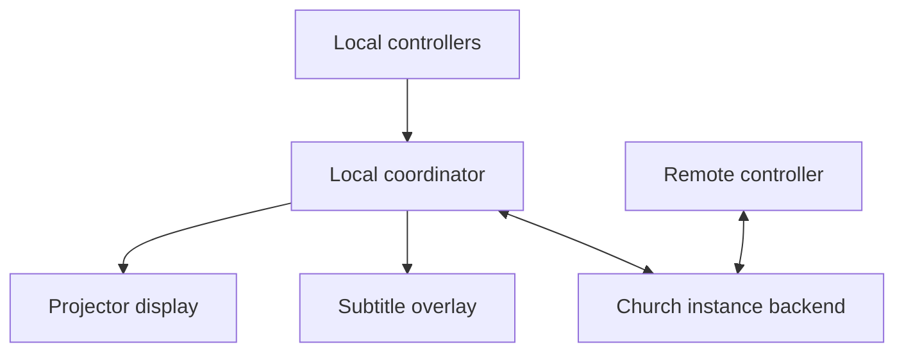

# Worship Q — Requirements and Architecture

**Consolidated:** 6 October 2026  
**Updated:** 10 October 2026  
**Status:** Open-source project requirements and proposed architecture; implementation design pending.

## 1. Purpose and decision status

Worship Q is a church lyrics and presentation application intended to serve multiple workspaces, from small fellowship meetings to services with a projector and a separate streaming computer. Volunteers should be able to operate it with little technical knowledge, retain their familiar lyrics-entry workflow, and reuse a workspace's setup each week.

Worship Q is intended to be an open-source project usable by different churches and organizations. Examples use generic workspaces and devices. Deployment-specific names and configuration belong outside this public specification.

The following labels distinguish the strength of decisions:

- **Agreed requirement:** explicitly requested or confirmed by the user.
- **Proposed design:** a recommendation discussed, suitable as a design baseline but not an implemented or fully validated commitment.
- **Open decision:** requires further design or validation.
- **Later:** a future feature outside the proposed first release.

Technology recommendations below reflect the discussion, rather than a fresh evaluation of current releases. Specific version claims, latency estimates, browser compatibility, and app-store fees are deliberately not treated as verified facts.

## 2. Name and product principles

**Product name: Worship Q.** The display name includes a space.

**Technical package and repository name:** `worship-q`.

**Selected tagline:** *Every screen. In harmony.*

**Registered project domain:** [worship-q.com](https://worship-q.com), as confirmed by the project owner. Registration does not imply a deployed website or configured hosting, DNS, or TLS.

The tagline emphasizes synchronized presentation and a sense of shared worship. It avoids “control,” which was considered too negative for public branding. Controller remains a useful technical role name in this specification.

Trademark and app-store name availability have not been checked. The open-source license and repository location remain undecided.

The product principles emerging from the discussion are:

1. Make routine operation simple for non-technical volunteers.
2. Provide a simple text-entry workflow and two-source-line default with church/workspace configuration.
3. Support desktop, browser, and eventually native mobile clients.
4. Allow a device to perform several roles simultaneously.
5. Keep local services usable when the cloud is unavailable.
6. Save workspace equipment configuration so it can be restored next week.
7. Keep normal-workspace resources private until central approval; privileged workspaces manage central resources directly.
8. Support several controllers and outputs against one authoritative live state.
9. Let churches deploy independent instances without relying on the public project website for normal operation.
10. Let a single desktop or phone present without any church instance; connecting to a church is an optional upgrade.

### Public website and self-hosted instances

**Agreed direction:** worship-q.com is the public introduction to the product. Churches that want to use Worship Q can deploy their own independent instance.

| Public project website: worship-q.com | Church-operated Worship Q instance |
| --- | --- |
| Product introduction, screenshots, and feature overview | Church accounts and administrative access |
| Downloads and links to source code | Songs, run sheets, workspace and device settings |
| Documentation and deployment instructions | Its own application backend, database, and assets |
| Public information without a church login | Access and administration managed by the deploying church |

The exact website content and deployment packaging are proposed; neither the website nor a church deployment has been implemented by this document. Domain registration is confirmed by the project owner, but hosting remains to be configured.

**Proposed deployment unit:** one instance per church or church organization, with multiple workspaces inside that instance. A single-workspace church should have a simple default setup rather than needing to configure a complex organization hierarchy. Hosting may be on church equipment, a rented server, or infrastructure managed by someone on the church's behalf; self-hosted does not mean the server must physically sit in the venue.

Each instance owns its accounts, database, song libraries, assets, and remote relay/synchronization services. The public project website is not the shared authentication service, global song library, or required relay for church instances. Cross-instance song sharing, federation, and a project-operated hosted backend have not been requested. app.worship-q.com is a link router only, described below.

**Terminology:** “Church Library” means the library shared across workspaces within one church's instance. “Cloud” or “remote server” in the architecture means that instance's backend, wherever the church deploys it. Self-hosting the instance and coordinating a live service locally are separate concerns: a venue coordinator and cache still support local operation when the instance backend is unreachable.

### Application distribution and admin hosting

**Proposed common-client approach:** publish a standard desktop/mobile build per platform that connects to compatible church instances through church-provided links or QR codes. Churches deploy their own backends without having to compile, sign, and distribute customized native apps. Church-specific preconfigured builds remain possible, but are not the recommended default.

Church-hosted web clients receive backend configuration during deployment. **Agreed direction:** **app.worship-q.com** is the domain used in QR joining links and acts as a thin link router, not a web client. The common desktop/mobile apps declare this one domain, so an installed app opens directly from a camera scan for any church. Without the app, the page shows the destination church domain and forwards the browser to that church's own hosted web client, carrying the invitation. The link identifies the church instance. The router connects to no church backend and handles no church data, and it must show the destination domain before forwarding so a forged link cannot silently send someone to an impostor site. The subdomain is not yet deployed.

| Component | Hosting direction |
| --- | --- |
| worship-q.com introduction, documentation, downloads | Project-operated |
| app.worship-q.com QR link domain and link router | Project-operated; forwards to the church-hosted web client |
| Admin web app | Recommended: bundled with each church instance; web only |
| Presentation web app | Included in every church deployment; the browser fallback for QR joining |
| Backend, database, assets, authentication, synchronization | Church-operated |
| Desktop/mobile apps | Common distributions, instance configured through onboarding |

The church-hosted admin app updates with its backend and uses the church's OIDC sign-in configuration. Because the web client is served by the church instance, it always matches its backend version, signs in on the church's own domain, and has its browser data kept apart from other churches by the browser. Church-hosted admin/presentation plus common desktop is the recommended initial delivery; native-mobile timing remains open. The link router is needed once QR joining ships, because joining links point to it. Joining by camera scan therefore depends on app.worship-q.com being available to route the link, an accepted exception to independence from project-operated hosting. Church data stays on the church instance.

**Agreed requirement:** clients, coordinators, and church instances negotiate a protocol version when connecting. Common desktop/mobile builds and church-hosted backends are released and updated independently, so version skew between them is expected. An incompatible client must show a clear update-needed message rather than failing unpredictably. The supported version window and update policy remain open.

Developers configure endpoints and the OIDC sign-in provider during deployment; volunteers should not enter technical addresses or ports. Custom app links and mobile HTTPS domain association need platform validation: arbitrary church domains must not be assumed to launch an installed app automatically. Knowing the instance address does not grant access.

**Agreed QR entry points:** volunteers can scan an invitation using their phone's normal camera without installing or first opening Worship Q. The QR should contain a browser-accessible HTTPS joining link. The intended experience opens the installed app when the platform/link association supports it, otherwise opens the browser joining flow. Scanning within Worship Q is an equally supported alternative. Both routes resolve the same instance/workspace invitation and require the same approval; scanning method does not change permissions. Without the app installed, a camera scan opens a web page and therefore needs internet. With the app installed and its link association already established, the phone can open the app directly from a camera scan without loading the page, so offline joining of a local coordinator works from either the camera or the in-app scanner (Section 10). Link association is fixed to domains declared in the app build, so a common app cannot rely on it for arbitrary church domains. **Agreed:** QR joining links use app.worship-q.com, which the common apps declare and which forwards to the church-hosted web client as the no-app fallback.

The router page should provide **Open in Worship Q** and **Continue to [church domain]** when automatic app opening is unavailable. Exact domain/link association and transfer of invitation context need platform validation, especially for independently hosted church domains. A custom app-only URL is insufficient as the sole camera QR payload because it lacks a usable no-app browser path.

### Connect to your church

**Agreed onboarding goal:** no volunteer entry of endpoints, ports, or other technical configuration. Common desktop/mobile apps receive instance configuration through a church-provided link or QR code and remember it. Church-hosted web clients know their own backend configuration. Permanent pairing and temporary remote joining are distinct flows described in Section 4.

Instance discovery/onboarding is separate from permission to control a workspace presentation. Saved credentials, caches, device associations, and output endpoints should be scoped to the instance. Changing instances must not mix their content or permissions. Supporting several saved instances on one client is an open decision, not a v1 commitment.

### Agreed user-facing library terminology

| Concept | User-facing label |
| --- | --- |
| Instance-wide shared song and background resources | **Church Library** |
| A workspace's private songs, song overrides, and backgrounds | **Workspace Library** |
| Submit a workspace resource for church-wide sharing | **Share with church** |
| Workspace setting enabling direct shared-library management | **Manage Church Library** |

“Share with church” retains administrator review and approval in normal workspaces. “Manage Church Library” is the privileged-workspace setting: it grants direct add/edit-song/remove operations on shared resources, including church-wide deletion. These are naming changes, not changes to ownership, approval, conversion, deletion, or override-detachment behavior. Avoid “central” and “privileged workspace” in user-facing controls; those terms may remain in technical explanations and internal identifiers. The Church Library belongs to one church instance and is not a global public library.

## 3. Operating scenarios

These are combinations of shared capabilities, not four separate products.

| Mode | Example | Roles and outputs |
| --- | --- | --- |
| Solo | Phone mirrored to a TV during fellowship | One device controls and presents locally |
| Simple | Workspace laptop connected to a projector | One desktop coordinates, controls, and presents on a second screen |
| Networked | Separate projector and streaming computers | Local coordinator synchronizes projector, overlay, and controllers |
| Remote | Someone controls from another location | Authorized commands travel through a cloud relay to the coordinator |

Other supported scenarios include one computer running the operator UI, projector presentation, and subtitle overlay; and several phones/tablets controlling a presentation hosted on a separate computer.

### Local-only mode

**Agreed direction:** the desktop app and a phone are usable without a church instance. A fresh desktop installation can create a local workspace, enter songs, build run sheets, and present on a second screen with no backend, database, domain, sign-in provider configuration, or pairing. Connecting to a church instance is an optional later step, not a prerequisite for the Simple scenario. A phone can likewise create a local workspace, enter songs, and present in the Solo scenario without an instance.

**Proposed scope:** local-only mode stores its workspace in the device's local database and covers workspace songs, run sheets, slideshow output, and typography/background settings. The Church Library, sharing, administration, remote control, and cross-device synchronization require an instance. Local-only desktop presentation is the proposed first implementation phase.

**Open decisions:** how local songs, run sheets, and settings move into a Workspace Library when the device later connects to a church; whether local-only mode includes LAN outputs and controllers; and how a phone obtains the client without an instance. No church-hosted web client exists for such a phone and app.worship-q.com is only a link router, so this needs either a native app or a project-hosted local-only web app that keeps data on the device and connects to no backend. Browser storage belongs to one web address, so local data held by a project-hosted web app could not move to a church-hosted client without an export/import step.

## 4. Users, device authorization, and onboarding

### Agreed roles and permissions

The generic product term is **Workspace**, replacing the church-specific term “branch.” A workspace can represent a congregation, venue, ministry team, or small group. Its actual name is prominent in the UI. The hierarchy is church instance → workspaces → dated run sheets, with live presentation state maintained separately.

| Access type | Responsibilities and limits |
| --- | --- |
| Administrator | Sign in through the church's configured OIDC provider, in the admin web app only; manage workspace access, permanent and temporary devices, all songs and backgrounds in the instance, and central promotions |
| Workspace operator | Admin-managed permanent authorization for one or more workspaces; manage run sheets, permitted songs and backgrounds, meeting days and presentation settings; present and approve remote controllers; in privileged mode, content management writes directly to the central pool |
| Remote controller | Approved connection to a workspace; control its active presentation, including jumping between songs/pieces and blank/unblank; no editing, changing the live or edited date, settings changes, or device enrollment |

**Agreed:** administrators sign in through a generic OpenID Connect (OIDC) provider that the church configures at deployment, such as Microsoft Entra ID (Microsoft 365) or Google Workspace. No provider-specific integration is required. OIDC sign-in establishes identity; Worship Q separately checks administrator authorization. Holding an account with the configured provider alone must not grant administration. **Open decisions:** how the first administrator of a new instance is designated, and whether one instance may configure several providers.

The earlier shared-account/password proposal is superseded by passwordless device authorization for ordinary operators and controllers. A workspace is a shared operational context; each device has a separately revocable credential. This does not require every volunteer to have a personal account or Microsoft login. Device names do not establish a verified human identity.

### Permanent pairing

**Agreed UX:** laptops, desktops, native phone apps, and browser clients can be permanently authorized. The proposed secure implementation is administrator-approved pairing based on the OAuth device authorization pattern.

1. Choose **Set up as a church device** (the permanent “Connect to a church” flow).
2. Use the church-provided link/QR to configure the instance without typing server details.
3. The requesting device displays a short-lived pairing QR and matching confirmation code.
4. An administrator signs in through the configured OIDC provider, verifies the request, selects workspace assignments and permissions, names the device, and approves.
5. The requesting client obtains its own credential and remembers the pairing.

An **Approve on this device** route can support same-computer browser setup. Permanent enrollment may require the instance backend to be available. Pairing credentials and grant protocols are implementation proposals requiring detailed design; QR content must not contain a shared password or the requesting device's private credential.

### Temporary remote connection

1. An authorized workspace device displays a rotating, short-lived invitation QR.
2. A volunteer scans it using the phone's normal camera or Worship Q's scanner. The HTTPS link opens the supported installed-app route or browser fallback, retaining the invitation context, and requests remote-controller access.
3. The volunteer sees **Waiting for approval**; authorized operators with the workspace open receive the request.
4. An operator verifies the matching confirmation code and approves.
5. The remote connection can control the workspace's active presentation.

Scanning requests access; it does not grant control automatically. Several authorized devices may receive a request, but the first approval resolves it for all. An invite is not permanent enrollment; remote controllers cannot invite others or grant permanent permissions by default.

**Latest agreed access lifetime:** remote access belongs to the workspace connection, not a particular date or run sheet. Changing the live run sheet does not require reapproval. This supersedes the earlier proposal to expire remote access at the end of a dated service. Explicit disconnect, operator removal, or revocation ends access. A short network-reconnection grace period is recommended; exact idle/max lifetime and host-restart behavior remain open. An invite expiring is distinct from an already approved connection expiring.

### Returning controller and home screen

After the first successful join, remember the church instance, workspace, and a revocable returning-device identifier. Remembering does not grant permanent permissions or automatically authorize a later connection.

- **Connect to [workspace name]** requests fresh approval without another QR scan.
- **Join another presentation** scans another invitation QR. Final labels may use “workspace” or “presentation” rather than introducing a managed Service entity.
- **Set up as a church device** begins permanent administrator-approved pairing.

If no presentation is active after approval, show **Waiting for presentation**. If the workspace or approving operator cannot be reached, show the reason and retain the QR joining alternative. Offline remembered joining requires an installed app and a reachable local coordinator; the remembered address alone is insufficient.

### One device, multiple workspaces and roles

Within a church instance, one device identity can have several permanent workspace assignments and additional temporary remote connections. It is not locked to a single workspace or role. Support several workspaces now; multiple independent church-instance profiles remain an open decision.

A leader's phone can have permanent access to **Wednesday Small Group**, while temporarily controlling **Sunday Worship**. A home laptop can be paired to Sunday Worship for advance preparation. A paired home laptop can prepare workspace content. Only administrators can approve permanent device pairing; workspace operators can approve temporary remote connections.

The phone's home screen can offer **Present → Wednesday Small Group**, **Connect → Sunday Worship**, and **Join another presentation**. Dedicated projector PCs may open directly into their usual workspace; personal devices need an activity choice. Starting local presentation explicitly leaves remote-control mode so gestures cannot affect the wrong workspace.

### Device administration and offline limits

The admin page lists permanently paired devices and temporary connections, assignments, permissions, last-seen information, and revocation controls. Operators can see current remote controllers and use **Disconnect all**.

Proposed credential storage uses OS-protected storage for native clients and secure server-managed browser sessions where appropriate. Browser pairing is specific to its browser profile; clearing data requires pairing again. Protocols, token lifecycle, browser cross-origin authentication, and offline credential validation remain implementation work.

A delegated local coordinator may approve temporary controllers that use the desktop or mobile app while offline; browser-only controllers need internet. Offline activity reaches the admin page after synchronization; a cloud revocation cannot instantly reach a disconnected coordinator. Define this limitation and the offline authorization policy explicitly.

## 5. Song libraries, workspace overrides, and promotion

### Agreed ownership and visibility

Administrators can view and manage all songs within their church instance. Workspace operators see the instance's central songs plus their own private songs, including workspace versions of central songs. Other workspaces' private songs are not visible. Remote access exposes only the presentation content needed for control, not general editing or private-library download rights.

| Viewer | Visible library |
| --- | --- |
| Workspace A operator | Central songs + Workspace A songs; A overrides replace their central versions in its normal view |
| Workspace B operator | Central songs + Workspace B songs; unaffected by A edits |
| Administrator | All instance songs and promotion submissions |

### Agreed normal-workspace override behavior

In a normal workspace, editing a central song automatically creates a private workspace copy linked to the original central song. It hides/replaces the central version in that workspace's normal library view. Editing thereafter changes the local version; it does not alter the central record. Central updates must not overwrite the workspace copy.

This resolves the earlier open question about local variants. Track the original by identifier, not title. Run-sheet song resolution must consistently honor the workspace override; the detailed reference/revision scheme remains open.

Recommended UI actions are **Workspace version**, **Restore central version**, and a non-blocking **Central version updated** notice. Restoring the central version is distinct from hiding a song. Normal-workspace operators can remove their private songs; removing a central song hides it locally rather than deleting it church-wide. Privileged-workspace removal deletes centrally, as described below. Exact deletion/reference recovery remains to be designed.

### Agreed sharing workflow — Share with church

A normal workspace can submit a private song for central review. An administrator approves or rejects the submitted revision. Approval makes the approved content available across that instance, not on worship-q.com or in other churches' deployments. Unreviewed later edits must not silently be published.

### Agreed privileged workspace mode

A workspace can operate in **normal** or **privileged** content-management mode. In privileged mode, its song/background management maps directly to the church instance's central pool. The proposed administrator-facing setting is **Manage Church Library**; the administrator controls the mode. Workspace operators gain central-content authority through this setting without needing to become admin-app users. Remote controllers retain presentation-only permissions.

| Operation | Normal workspace | Privileged workspace |
| --- | --- | --- |
| Add song | Create private workspace song | Create central song |
| Edit central song | Create/update private linked override | Edit central song directly |
| Remove central song | Hide locally | Delete centrally |
| Add image/video background | Create private workspace asset | Create central asset |
| Remove central background | Local hiding only; cannot delete church-wide | Delete centrally |
| Edit background | Not supported | Not supported |

This privilege concerns content management, not administrator access, permanent-device enrollment, presentation-role assignment, or church-wide configuration. The workspace's run sheets, calendar, output setup, and active presentation remain its own.

### Agreed workspace mode transitions

| Transition | Resource behavior |
| --- | --- |
| Privileged → normal | Stop central-write authority; existing central resources remain central. Future additions are private, and future central-song edits create local overrides. Do not copy the Church Library into the workspace. |
| Normal → privileged | Merge existing private songs and backgrounds into the central pool. Apply linked local song overrides to their central songs, replacing central content with the local versions. Cancel local hiding rules so still-existing hidden central resources reappear. |

“Local deletion” in this conversion means hiding a central item from the workspace list. Cancelling that hiding does not resurrect actually deleted private resources or centrally deleted records. Backgrounds have no override relation: their private uploads become central assets. A title/filename match alone must not be treated as an override link or automatic replacement.

Preserve run-sheet references and selected-background references through conversion. Other workspaces' private songs and existing overrides remain private/intact when central versions change. The former local copies in the converted workspace resolve to the resulting central resources; exact identity/reference migration requires design.

**Agreed conversion UX:** before enabling **Manage Church Library**, show the administrator an explicit warning that private resources become central, linked overrides replace the central songs church-wide (including for workspaces without their own override), and hidden resources reappear. The administrator confirms the conversion as a whole; choosing override by override is not required. **Later:** per-song confirmation for overrides whose central song changed after the override was made. **Proposed:** list the affected resources in the warning and flag central revisions changed since the override was made. Apply the confirmed conversion and reference updates coherently; conflict resolution, duplicate handling, recovery, and treatment of offline clients remain implementation decisions.

### Agreed central deletion and override conversion

Deleting centrally, through an administrator or privileged workspace, removes the central resource from the shared pool. For a deleted central song, **all existing workspace overrides become independent private songs in their respective workspaces**. Retain their lyrics, ownership, and run-sheet references while removing the active override relationship. They remain available only in their owning workspace.

Source central-song identifiers can remain in history for traceability. If central restoration is implemented, restoration should not automatically reconnect these independent songs as overrides. There is no corresponding background-override conversion, because background overrides do not exist.

**Proposed deletion UX:** make central deletion recoverable, show affected references, and preserve existing live output until an explicit presentation change. These are recommendations, not a finalized deletion/recovery algorithm. References to a centrally deleted song with no local override, selected deleted backgrounds, and offline edits against deleted records need explicit recovery rules.

### Proposed canonical record policy

On approval, establish a canonical central record, preserve origin/history, and migrate appropriate local references to avoid unnecessary duplicate maintenance. Exact behavior for a promoted override, an existing central duplicate, later workspace edits, and offline references remains open. Preserve deliberately maintained overrides rather than silently discarding them.

## 6. Lyrics format and slide generation

### Agreed requirements

- Keep lyrics as manually editable text.
- Blank lines separate blocks of lyrics.
- Within each block, group the configured number of consecutive **source lyric lines** into one logical slideshow/subtitle piece. The default is **2**; churches or workspaces may choose another count, such as **4**.
- Configure source lines per piece at church level with a workspace override. There is no song-level override, and the effective count is shared by slideshow and subtitle output.
- Configure automatic long-line wrapping for the slideshow at church level with a workspace override, **enabled by default**. When enabled, a long source line can be displayed as two visual lines on the slide. Subtitle output preserves source-line boundaries and does not apply this automatic wrapping.
- Do not require volunteers to label verses, choruses, or bridges in the first version.
- The app is language-agnostic: it does not detect, label, or count languages, and the configured line count applies literally to source lines. Users arrange languages however they want, for example alternating lines in two languages entered manually. English and Chinese in the examples are illustrative, not mandatory languages.

Example source text using the default two-source-line setting:

```text
English line one
中文第一行
English line two
中文第二行

English line three
中文第三行
```

| Generated piece | Contents |
| --- | --- |
| Block 1, piece 1 | English line one + 中文第一行 |
| Block 1, piece 2 | English line two + 中文第二行 |
| Block 2, piece 1 | English line three + 中文第三行 |

### Proposed implementation

Store raw lyrics and derive logical pieces without modifying the source text. Avoid storing generated slides as the sole content representation. No language detection is required for grouping: source lines retain their supplied order.

### Intended formatter design

This configurable design supersedes the earlier fixed two-line v1 rule. Distinguish **source lines**, **logical pieces**, and **visual lines**. Blank lines separate blocks; grouping must not cross those boundaries. Slideshow wrapping never creates extra navigation pieces or changes the stored lyrics.

| Configuration | Church default | Workspace override | Song override |
| --- | --- | --- | --- |
| Source lines per logical piece | 2, configurable (for example, 4) | Yes | No |
| Slideshow long-line wrapping | Enabled; a long source line may occupy two visual lines | Yes | No |
| Subtitle automatic wrapping | Not applied; preserve source-line boundaries | Not applicable | No |

Use shared logical-piece generation followed by **two formatter components**:

1. **Slideshow formatter:** determine one automatic font size for the song on that output and determine whether/where each source line needs a visual break when wrapping is enabled.
2. **Subtitle formatter:** independently determine one automatic font size for the song on that output while retaining the original source-line boundaries, with no automatic long-line breakdown.

Both formatters use the relevant output area, selected font family, and scale adjustment. They consume the same logical piece IDs so navigation remains synchronized even when the visual line counts differ. Each output keeps its calculated size consistent across a song; sizes need not match between output types or differently sized displays.

For example, a default piece with a long English source line and one Chinese source line remains one piece on both outputs. The slideshow may display the English across two visual lines plus the Chinese line, while the subtitle keeps the original two lines. With four source lines, wrapping can produce up to eight visual lines in a slide without creating additional pieces.

**Algorithm intentionally deferred:** the exact font-sizing method, long-line threshold, break positions, fitting order, language-sensitive break rules, overflow handling, and recalculation behavior will be designed later. The earlier suggested target-size-first procedure is not a selected algorithm.

Unspecified parser behavior includes blocks whose line counts are not divisible by the configured piece size, whitespace-only separators, consecutive blank lines, newline normalization, and preserving intentional spacing. These need explicit rules before implementation.

Automatic translation is a **later, optional editing aid**, not a dependency of the song format. Semantic song sections were considered and deferred to preserve the existing workflow.

## 7. Calendar planning, dated run sheets, and live presentation

### Agreed planning experience

The calendar replaces a separate user-managed “Service” concept. Workspace operators manage **song-only dated run sheets** in v1. Bible passages and uploaded slide decks are later features. Trusted coworkers can pair a home device to the workspace and prepare content remotely; plans synchronize to authorized presentation equipment.

Users can search songs, add/reorder/remove items, and browse previous dates to reuse content. Distinguish the browsed date, the date being edited, the active (live) date/run sheet, and the piece currently on screen.

### Meeting-day configuration

Workspace operators can select multiple meeting days. Default selection is Sunday. Date calculation uses the workspace timezone; no matching rule should depend on an operator's travel timezone.

| Selection | Label | Default calendar date |
| --- | --- | --- |
| None | **Any day** | Today |
| All seven days | **Every day** | Today |
| Some days | Selected day names | Next matching day, including today |
| Initial default | **Sunday** | Next Sunday, or today if Sunday |

Preserve the actual selection: Any day and Every day have the same date behavior but different labels and intent.

### Agreed live-state model

Each workspace has at most one live state, shared by every connected client and view. It combines:

- the live run sheet, which is a link to a dated run sheet rather than a copy;
- the presented content (the piece on screen);
- the blank state;
- the connected devices;
- its status: live or ended.

1. **Start:** when the first operator device connects, it uses the previous live state if that has not expired. Otherwise, if today has a run sheet, a new live state starts with that run sheet and nothing presented. If there is no live state and no run sheet for today, a new live state starts with the run sheet of the next configured meeting date, today included, and nothing presented. An ended live state counts as no live state here. The app opens on the presenting view.
2. **Join:** any further operator device synchronizes with the current live state rather than replacing it.
3. **Expiry:** when no operator device is connected, the live state expires after a period of time. Only operator devices count; a connected remote controller or a device in viewer mode does not keep it alive. The period is an open decision.
4. **Go live:** any operator device can go live; the live run sheet then links to the run sheet that device is previewing. Edits made in live mode are edits to that dated run sheet, so they are kept when the live state ends or expires.
5. **Presenting:** any operator device or remote controller can select a piece from the live run sheet to populate the presented content.
6. **Resource updates:** changes to the resources in use, such as fixing a typo in lyrics or changing display settings (fonts, background, wrapping), update the live run sheet and the presented content.
7. **Run-sheet changes:** the presented content does not update immediately when the live run sheet changes; it stays until another piece is selected or the output is cleared.
8. **Ending:** the live state can have an ended status. The app has no manual end control, because **Clear screen** takes content down and a red end button was easily mistaken for closing the slideshow. When a live state has been kept for too long, operator devices show a notification offering to end it and move to the next planned date; nothing ends automatically while an operator device is connected.
9. **Backup:** the live state is backed up to the church instance, so that if one device fails a second device can recover it.

**Terminology:** “operator device” means a connected client with workspace-operator rights that is not in viewer mode. Several can be connected at once. The **coordinator** (also called the host) is the one operator device that currently holds and orders the live state; this is the technical role in Sections 9 and 10.

**Agreed viewer mode:** a device with workspace-operator rights can be in viewer mode. While in viewer mode it does not count as an operator device: it does not start a live state, keep one alive, or become the coordinator. Entering and leaving viewer mode is a manual choice, never automatic. The choice is saved on the device and survives closing and reopening the app, so a projector PC configured as a viewer always opens as a viewer until someone exits the mode. **Proposed:** viewer mode is read-only. **Open decision:** what a viewer can see.

**Agreed remote hosting:** an operator device at another location may start and host the live state, for example when nobody on site can operate. Venue outputs then follow it through the church instance and need internet.

**Proposed details:** the coordinator holds and orders the live state and mirrors it to the church instance, which keeps the backup until expiry; every joined operator device also holds a synchronized copy, so recovery on the LAN does not depend on internet. Ending clears the outputs and puts operator devices into edit mode for the next configured meeting date after the ended one. An ended live state stays ended until an operator goes live again, edits a run sheet (which goes live with it), restarts the app, or it expires. The threshold for the kept-too-long notification is open.

### Calendar and live-state behavior

**Agreed:** a browsed date offers two separate actions, **Go live** and **Edit run sheet**. They replace the earlier single **Switch to this date** action, which forced a date to become live before its plan could be edited.

| Action | Result |
| --- | --- |
| First operator device connects and an unexpired live state exists | Use that live state, including its presented content and blank state |
| First operator device connects, no live state exists, and today has a run sheet | Start a new live state linked to today's run sheet; this does not implicitly play a slide |
| First operator device connects, no live state exists, and today has no run sheet | Start a new live state linked to the run sheet of the next configured meeting date, today included; this does not implicitly play a slide |
| Another operator device or remote controller connects | Synchronize with the current live state without resetting it |
| No operator device remains connected | The live state expires after a set period; remote controllers and devices in viewer mode do not keep it alive |
| Operator ends the live state manually | Live state becomes ended |
| Browse a different calendar date | Read-only view; live run sheet and displayed content remain unchanged |
| Choose **Edit run sheet** on a browsed date | Open that date's plan in edit mode on this device; the live run sheet and displayed content remain unchanged |
| Choose **Edit run sheet**, or edit a run sheet, while nothing is live | Go live with that run sheet; nothing is implicitly played |
| Copy items from a browsed date | Copy to the run sheet open in edit or live mode on this device, with its explicit date shown in the action |
| Copy into an empty target | Apply immediately |
| Copy into a non-empty target | Offer **Append** or **Replace**; confirm Replace |
| Choose **Go live** on a browsed date | Replace the active/live run sheet with that date's plan, which stays editable in live mode; retain the currently presented slide |
| Actually play a piece from the new run sheet | Update presentation outputs to the new content |
| Live state kept too long while an operator device stays connected | Show a highlighted, dismissible notification to end it and move to the next planned date; no automatic end or live switch |

The currently displayed piece can belong to the previously active run sheet after **Go live**. Retain the necessary presentation snapshot until another piece is played or output is cleared. A clear **Still presenting previous content** indication is recommended. **Go live** alone must not change the on-screen song or its appearance; edits to the presented song and changes to display settings do update it.

Copying creates independent run-sheet items retaining song references, not duplicated song-library records. Editing the target plan must not mutate the source date. **Agreed:** the run sheet is editable in both edit mode and live mode. Live mode is a special edit mode; the only difference is that live mode is synchronized with the live state shared across all clients and views of the workspace. Edit mode opens a date's run sheet on this device without changing which date is live or what is displayed, so a coworker can prepare a future date at home while another date is live in a service. Browsed alternate dates are read-only until **Edit run sheet** or **Go live** is chosen. Changes in either mode are saved to the dated run sheet and synchronized as plan content. **Proposed:** the date open in edit mode is a per-device choice, not part of the shared live state. Playing/navigation remains flexible, allowing any song or piece in the live run sheet rather than rigid sequential playback.

### Proposed bounds and remaining details

One run sheet per workspace per date and one authoritative live presentation per workspace are the proposed v1 defaults. Multiple same-day named plans or simultaneous presentations in one workspace are not yet specified. Remote controllers can jump around the active plan but cannot use **Go live** or **Edit run sheet**, or copy/edit content.

Give each item its own identity, including repeated songs. Keep dated plans and live-state coordination separate internally. Historical lyric-version retention, copy behavior for unavailable songs, and append/replace handling of an already displayed item need implementation rules consistent with retaining output until an explicit presentation action.

## 8. Live editing and multiple controllers

### Agreed requirements

Users can edit lyrics during a service and have displays update. The proposed system also supports multiple controllers and synchronized outputs.

### Proposed design

The active coordinator serializes accepted commands and maintains an authoritative live state. Lyrics edits create revisions and reach the coordinator before outputs apply the resulting change.

Editing a later piece should not unexpectedly advance the current presentation. Structural edits can shift indices, so the design needs a deliberate policy for preserving the current location. Candidate approaches include stable internal piece identities and explicit handling when a current piece is deleted or becomes ambiguous. No matching algorithm has been selected.

Live command delivery and content synchronization should be distinct concerns. Reconnection must restore an authoritative snapshot; duplicate commands must not advance twice. Revision numbers, command IDs, conflict responses, and transport-switch handling are proposed protocol mechanisms, not a finalized schema.

Central-song edits follow the workspace override rule in normal mode and update central content directly in privileged mode. Remaining editing policies include concurrent edits, how revisions resolve in live references, exact structural-edit location matching, and conflict review after offline edits.

## 9. Client roles and capabilities

These runtime roles are separate from the Administrator, Workspace operator, and Remote controller access types in Section 4:

| Role | Responsibility |
| --- | --- |
| Coordinator (host) | The operator device that owns the live state and orders commands |
| Controller | Navigate the workspace's active presentation |
| Display | Render the slideshow |
| Overlay | Render the subtitle overlay for compatible consumers, including OBS |

One client may hold several roles. “Host” does not imply “controller.” A solo browser can coordinate its own local presentation without being able to host a LAN server for other clients.

Each client should advertise capabilities rather than having abilities inferred solely from its operating system. Candidate capabilities include presentation/control support, font access, screen enumeration, transparency, media playback, client version, and reachable transports. These fields need a validated protocol definition.

User-facing language should emphasize “Start presenting,” “Connect to [workspace],” “Join another presentation,” “Slideshow,” “Subtitle overlay,” and “Connected devices.” Technical topology should usually be handled internally.

## 10. Connectivity and live-state authority

### Proposed architecture: cloud-managed, locally operated

**Agreed:** the coordinator is an operator device and need not be a desktop. A desktop-app coordinator can be reached directly over the LAN; a browser coordinator is reachable only through the church instance backend; whether a native mobile app can serve LAN clients is open. A capable desktop is the recommended coordinator for a venue. Local controllers and outputs communicate with the coordinator directly when reachable. The church-operated instance backend supports authentication, library and plan synchronization, workspace configuration, remote control, and relay fallback. References to cloud services describe this backend, not worship-q.com.



The cloud need not sit in the critical live-presentation path when a local coordinator is available. Remote commands still reach that same authority through the relay.

Prefer LAN when reachable, use cloud relay when necessary, and support standalone local presentation when neither is available. Falling back to standalone must be explicit if it creates a separate live state; clients must not silently become competing authorities for the same workspace.

**Agreed client connectivity rule:** direct LAN connection to the coordinator, and therefore operation without internet, is for the desktop and native mobile apps. Browser-only clients (controllers, browser displays, and overlay pages on computers without the desktop app) connect through the church instance backend and require internet. **Agreed exception:** the desktop app serves slideshow and subtitle-overlay pages on localhost for software on the same computer, such as OBS. These work without internet because the app holds the connection to the coordinator; a streaming computer separate from the coordinator gets this by running the desktop app. This avoids depending on browser access to local endpoints, which secure-context, mixed-content, and local-network rules restrict. A browser presenting its own cached content in Solo mode does not connect to a coordinator and is unaffected.
For v1, one clearly identified coordinator was recommended. Automatic leader election and seamless host failover are not promised. Coordinator loss and internet loss are different failures.

**Agreed requirement:** LAN connections between clients and the coordinator are authenticated and encrypted, so that other devices on a shared venue network cannot read credentials, send commands, or pose as the coordinator. **Proposed:** pairing and invitation QR codes carry the coordinator's public key, and each side proves its identity when connecting. The exact protocol is open and belongs with the pairing design.

### Discovery and router configuration

The target is no special router configuration on an ordinary network that allows device-to-device communication. Proposed discovery options are mDNS for capable native clients, QR/joining links, and cloud assistance.

Constraints requiring validation:

- Guest/client isolation can block direct LAN communication even when internet access works.
- Multicast filtering can prevent discovery while direct connectivity remains possible.
- Host firewalls may require local inbound permission.
- Ordinary web pages cannot be assumed to browse mDNS services directly.
- Browser restrictions on secure contexts, mixed content, local-network access, and permissions complicate a cloud page connecting to a local endpoint.

A QR code helps locate and join a host; it cannot bypass network isolation or browser security. Cloud fallback requires the coordinator and relevant clients to reach the cloud. No router-level workaround is promised.

## 11. Slideshow, subtitle overlay, typography, and backgrounds

### Output terminology and clients

**Agreed terminology:** use **Slideshow** for the full presentation and **Subtitle overlay** for the subtitle output. OBS is one integration, not the name or exclusive consumer of the overlay.

A desktop application must not be required on every display. Support desktop presentation windows, browser displays, and subtitle-output browser endpoints usable by compatible software such as OBS. They share logical song/piece state but have separate output layouts, typography, and backgrounds/transparency. Browser displays and overlay endpoints on computers without the desktop app connect through the church instance and need internet; the desktop app serves them on localhost for same-computer software such as OBS (Section 10).

### Agreed typography configuration

| Setting | Slideshow | Subtitle overlay |
| --- | --- | --- |
| Font family | Church default, with workspace override | Separate church default, with workspace override |
| Font size | Automatically fit to this output; consistent within each song | Automatically fit to this output; consistent within each song |
| Adjustment | One scale slider | One scale slider |

There are **two sliders total**, one per output type, rather than separate width/height controls. No per-song font-family or manual size configuration. Size is derived per song by the renderer, not an author-editable song property.

The separate slideshow and subtitle formatters described in Section 6 calculate a consistent size across the song using actual font metrics, text width/height, and available output area. The intended result fits all pieces; slideshow formatting also determines visual breaks when enabled, while subtitles preserve source lines. Different outputs may calculate different sizes. Each slider adjusts its output type's automatic size. The exact sizing/wrapping algorithm, safe areas, slider limits, overflow behavior, font-loading timing, and recomputation after edits/resizing are deliberately deferred.

Church/workspace settings express intended typography; output devices report their ability to render it. This supersedes the earlier device-owned font-family configuration. Persist output-specific hardware/layout settings without introducing per-song typography.

| Client | Proposed font capability reporting |
| --- | --- |
| Desktop | Enumerate installed fonts through native/platform APIs |
| Supporting browser with permission | Enumerate through Local Font Access where available |
| Other browsers | Bundled/configured web fonts and explicit fallback behavior |

Validate chosen families on each output, including glyph coverage for the languages in its lyrics. Unknown system-font availability is not confirmed availability. Configure fallback behavior and cache supplied fonts for offline use; enumeration and successful rendering are separate checks.

### Agreed background pools

Background materials follow song ownership and promotion, but not song editing/overrides.

| Option | Behavior |
| --- | --- |
| Central image/video | Shared within the church instance; administrators and privileged-workspace operators add/remove central assets |
| Workspace image/video | Uploaded/removed in normal workspaces; private until approved promotion or conversion to privileged mode |
| Solid color | Direct background setting; no upload or promotion needed |

Support validated image and video types. Uploaded assets are immutable: add/remove only, no editing, no workspace override. Replacing content requires a new upload. A normal workspace cannot remove a central asset church-wide; a privileged workspace removes it centrally. An administrator can review a submitted workspace background and promote it to the central pool.

### Proposed media behavior

- Select backgrounds within output settings; slideshow may use image/video/color while subtitle overlay can remain transparent.
- Cache selected media for offline use and show missing/unsupported asset readiness.
- Loop video backgrounds and mute audio by default; these defaults are recommendations pending confirmation.
- If an asset is removed while displayed, retain the live background where technically possible until another is selected; if unavailable when needed again, fall back to the configured solid color. Final removal/in-use handling is open.

Exact file formats, codecs, size limits, playback behavior, and promotion reference migration require validation across desktop, browser, mobile, and overlay consumers. Extensions alone do not establish compatibility. Background-setting changes during a live presentation need an explicit apply policy.

## 12. Phone-to-TV presentation

### Agreed scenario

In a small-group meeting, one phone should both display lyrics and control them while its screen is mirrored to a TV. Swiping the presentation should navigate the lyrics.

### Proposed Presenter Mode

- Open a prepared/cached dated run sheet or song in an authorized workspace or a local workspace.
- Choose “Present on this device.”
- Show a clean lyrics view with controls normally hidden.
- Swipe to navigate; exact direction conventions require testing.
- Tap to temporarily reveal explicit navigation and exit controls.
- Keep additional gestures conservative to reduce accidental navigation.

With ordinary screen mirroring, presentation controls shown on the phone also appear on the TV. A separate controller UI on the phone and clean lyrics on the TV requires a true external-display capability, not ordinary mirroring.

External-display support is a future platform-specific enhancement. Offline lyrics playback does not imply wireless mirroring works without a local network or platform-specific connection; the transport to the TV must be tested separately.

## 13. Persistent workspace setup and repeat operation

### Agreed goal

Configure equipment once and reuse it without repeating technical setup. Restore persistent instance/workspace authorizations and output assignments; initialize the calendar/live run sheet according to Section 7, or join existing authoritative state.

Dedicated workstations open their usual workspace. Personal devices can choose among authorized workspaces, local presentation, and temporary remote control. A remembered temporary connection still requires fresh approval after access ends.

### Proposed Workspace Setup Profile

Persist workspace identity, device/output assignments, each device's viewer-mode choice, preferred coordinator, monitor preferences, layout/background settings, and church/workspace typography inheritance. Discover current LAN endpoints by identity instead of relying on last week's DHCP addresses.

The normal flow is open equipment → restore assignments/connectivity → see the relevant calendar plan or existing active state → present. Presenting must be an explicit action; initial plan population must not unexpectedly replay last week's slide.

### Stable output endpoints

Persistent slideshow/subtitle output identities follow the workspace's active presentation. External consumers such as OBS retain their configured URL across dates and run-sheet changes. Remote endpoints use the church instance; public website hosting is not the church runtime authority. Final endpoint and authorization formats remain open.

An overlay URL served on localhost by the desktop app works without internet and must keep a stable address and port across restarts so OBS needs no reconfiguration. Browser-based outputs on computers without the desktop app are reached through the church instance and do not work without internet (Section 10). One workspace's active presentation must not replace a different workspace's output.

Monitor indexes can change. Save richer display identity where possible and recover safely when preferred hardware is missing. Browser fullscreen may still require a user gesture.

## 14. Offline operation and synchronization

### Agreed direction

Use local caching so a configured workspace can operate without the remote server.

### Proposed offline target

A workspace that has successfully cached the necessary content should be able to start a local service, navigate songs, edit lyrics, and create/change run sheets without cloud access. Queue eligible changes for later synchronization. Normal-workspace promotion can be queued but cannot be approved centrally while disconnected. Privileged edits, mode changes, central deletions, and override detachment require revision-aware synchronization; offline operations must not bypass a later privilege downgrade or resurrect deleted central content. The exact authorization/conflict rules remain open.

Candidate cached content:

- Workspace configuration and device/output assignments.
- Selected or available central songs and workspace songs.
- Run sheets and song revisions needed by them.
- Background media and supplied fonts.
- Pending content changes and submissions.

Cache completeness needs to be visible. Prior synchronization does not guarantee every song or asset is cached. Browser storage can be cleared or evicted; native SQLite persistence and browser persistence have different reliability constraints.

Live state should not be replayed as ordinary content edits when the cloud returns. Content synchronization needs conflict handling, revision tracking, migration/deletion rules, and a decision about whether to cache the whole library or selected content.

## 15. Proposed technology baseline

| Area | Recommendation/status |
| --- | --- |
| Desktop shell | Tauri 2; preferred proposal, pending technical validation |
| UI | React + TypeScript |
| Frontend build | Vite |
| Native desktop core | Rust |
| Church instance backend | TypeScript + Fastify preferred; Java/Spring Boot remains a valid alternative |
| Instance database | Self-hosted PostgreSQL |
| Native local database | SQLite |
| Browser local storage | IndexedDB/cache mechanisms; detailed strategy open |
| Live transport | WebSocket locally and through cloud relay |
| Discovery | mDNS for capable clients, plus joining alternatives |
| Protocol validation | Shared schemas; Zod proposed for TypeScript and generated/compatible Rust types |
| Styling | Tailwind proposed |
| OBS integration | Browser Source |
| Assets | Local cache plus remote media/object storage |

PostgreSQL matches the relational domain of workspaces, users, songs, revisions, plans, and permissions. A church may connect its instance to an existing PostgreSQL deployment or provision a new one. Supabase was not considered necessary for the proposed baseline. DynamoDB was discussed but not recommended for the core model.

Self-hosted installation documentation should cover backend configuration, database and asset storage, initial administration, reachable URLs/TLS, upgrades, and backup/restore. Container packaging, a reference deployment configuration, minimum server resources, and hosting support boundaries remain open implementation decisions. Routine server administration is distinct from the volunteer's weekly presentation workflow.

Tauri's native core is a candidate for local serving, discovery, database access, fonts, displays, media, and cloud synchronization. Its system webviews mean rendering and media behavior need cross-platform testing. Electron remains an alternative if a consistent bundled browser engine proves more important than the Tauri trade-offs. LAN hosting is possible with either approach and does not by itself prove Tauri superior.

A WebSocket client plugin does not implement the proposed local WebSocket server; that server is separate native-core work. No specific Tauri release or API is a hard dependency until checked.

### Repository organization

**Agreed decision:** keep the source code for the public worship-q.com website in the same open-source repository as the Worship Q application. The repository is named `worship-q`. Use a monorepo with separate applications rather than maintaining a second website repository.

**Proposed directory layout:**

```text
apps/
  website/       # Public worship-q.com introduction website
  router/        # app.worship-q.com link router
  web/           # Church-hosted presentation web client
  admin/         # Church-hosted administration web app
  desktop/       # Desktop client
  server/        # Church-instance backend
packages/
  protocol/      # Shared schemas and types
  renderer/      # Shared presentation rendering
docs/            # Project and deployment documentation
```

The layout is a starting proposal; exact package boundaries, workspace tooling, and future native-mobile placement remain open. The public website can reuse branding and documentation where useful, without depending on application internals unnecessarily.

**Build and deployment boundaries:** the public website and church application have separate build targets, deployments, and release workflows. Updating website copy should not require a church-application release. Churches should be able to build and deploy their instance without deploying the public website. The shared repository does not introduce a runtime dependency on worship-q.com.

Website content stays public and generic. Church-specific configuration, credentials, and private data remain outside the repository. Keeping website and application source together allows documentation, screenshots, and feature descriptions to evolve alongside the relevant application changes.

## 16. Native mobile strategy

**User preference:** native iOS/Android apps, with concern about publishing costs.

**Proposed rollout:** browser/PWA functionality initially, while designing the protocol to support native clients later. This was a recommendation rather than an explicit user agreement to defer native apps. Because browser-only clients require internet (Section 10), phones need internet to control another device's presentation until native apps exist.

Evaluate Tauri mobile against alternatives such as React Native when implementation scope is settled. Compare external displays, casting, offline persistence, discovery, background behavior, signing, review, distribution, and ongoing maintenance. Publishing fees and distribution options have not been checked in this consolidation.

## 17. Scope matrix

The broad first-release scope below was proposed in the discussion. It is not yet an implementation estimate or phased delivery plan.

| Feature | Status |
| --- | --- |
| Public introduction website at worship-q.com | Agreed direction; website content proposed |
| Public website and application source in one monorepo | Agreed decision; directory layout proposed |
| Independent church-operated instances | Agreed direction; packaging open |
| Church Library and promotion confined to an instance | Deployment model clarification |
| One-time client connection to a church instance | Agreed UX; protocol proposed |
| Local-only desktop presentation without a church instance | Agreed direction; proposed first phase; migration into an instance open |
| Local-only phone presentation without a church instance | Agreed requirement; how the phone obtains the client is open |
| Protocol version negotiation between clients, coordinators, and instances | Agreed requirement; version window open |
| Admin web app with generic OIDC sign-in | Agreed; provider configured per instance; first-administrator designation open; church-hosted packaging recommended |
| Paired workspace operators and approved remote controllers | Agreed model; replaces shared-password proposal |
| Multiple authorized workspaces/roles on one device | Agreed direction |
| Remembered workspace rejoin with fresh approval | Agreed UX |
| Camera or in-app QR scanning; installed-app opening with browser fallback | Agreed UX; platform routing to validate |
| Remote access survives date/run-sheet changes while connected | Agreed requirement |
| app.worship-q.com as QR link domain and link router to the church-hosted web client | Agreed direction; not yet deployed |
| Central + private workspace libraries | Agreed requirement |
| Workspace override when editing central songs in normal mode | Agreed requirement |
| Privileged workspace directly managing central songs/backgrounds | Agreed requirement |
| Normal → privileged merges private assets, applies linked song overrides, clears hiding | Agreed transition rules; explicit warning and single confirmation agreed; conversion mechanics open |
| Privileged → normal retains central resources and changes future write scope | Agreed transition rules |
| Central deletion converts song overrides to independent private songs | Agreed requirement |
| Promotion for central approval | Agreed requirement |
| Raw lyrics; blank-line blocks; configurable source lines per piece (default 2) | Agreed requirement; church default and workspace override, no song override |
| Slide-only automatic long-line breakdown into two visual lines | Agreed requirement; default enabled, church/workspace setting |
| Separate slideshow and subtitle formatter components | Agreed intended design; exact algorithms deferred |
| Language-agnostic lyrics; multilingual arrangement entered manually | Agreed requirement |
| Song-only run sheets | Agreed requirement |
| Calendar browsing, copy Append/Replace, separate Go live and Edit run sheet actions | Agreed requirements |
| Meeting days: Sunday default, Any day/Every day distinction | Agreed requirements |
| Keep displayed slide until another is played after Go live | Agreed requirement |
| Dismissible next-meeting action after active date passes | Agreed requirement |
| Shared per-workspace live state with expiry, manual end, and instance backup | Agreed model; hosting details, periods, and end label open |
| Viewer mode on devices with operator rights | Agreed; manual and remembered across restarts; does not start, sustain, or host a live state; visible content open |
| Any operator device as coordinator, including one at another location | Agreed; desktop recommended for a venue |
| Live lyrics editing | Agreed requirement |
| Browser display alongside desktop | Agreed requirement; browser-only clients require internet |
| Offline LAN control and display through desktop/mobile apps only | Agreed rule |
| Authenticated, encrypted LAN connections to the coordinator | Agreed requirement; protocol open |
| Separate slideshow/subtitle font families: church default, workspace override | Agreed requirement; no per-song configuration |
| Automatic fit, consistent size per song per output, two scale sliders | Agreed requirement |
| Central/private image and video backgrounds with promotion | Agreed requirement; no editing or overrides |
| Solid-color background option | Agreed requirement |
| Phone controlling and presenting via mirroring | Agreed scenario |
| Reusable weekly workspace setup | Agreed goal |
| Offline cache | Agreed direction |
| Device identities and capability reporting | Proposed foundation |
| Multiple controllers and synchronized outputs | Proposed v1 scope |
| Tauri desktop application | Proposed v1 implementation |
| LAN coordination and cloud relay | Proposed v1 architecture |
| Subtitle overlay, including OBS integration | Agreed terminology; proposed v1 integration scope |
| Full offline editing and conflict synchronization | Proposed target; rules open |
| Bible passages | Later |
| Uploaded slide decks, PowerPoint/PDF handling | Later; formats/workflow open |
| Automatic translation | Later, optional |
| Native mobile applications | User preference; release timing open |
| Semantic verse/chorus structures | Deferred |
| True mobile external-display presentation | Later/platform-dependent |
| Automatic coordinator failover | Deferred; not promised for v1 |


## 18. Candidate domain model and protocol

The next design step is to define the domain model and realtime protocol before finalizing implementation details. The monorepo direction is agreed, while its detailed package boundaries remain proposed. The following entities are candidates, not final schemas.

| Entity | Meaning |
| --- | --- |
| Instance | Independent deployment for one church or church organization: backend, data, client connection settings, workspaces, and the Church Library |
| Workspace | Operational boundary with normal/private or privileged/central content-management mode |
| Admin identity / permission | OIDC-authenticated administrator and server-validated rights |
| Device | Durable installation/browser identity |
| Workspace assignment | Permanent device rights, potentially for several workspaces |
| Pairing request / invitation | Pending enrollment or remote-connection request |
| Remote connection | Approved workspace control, independent of run-sheet date |
| Client | A running connected instance with roles and capabilities |
| Song / song revision | Content, ownership, and edit history |
| Workspace song override | Private version linked to central song; becomes independent private song upon central deletion |
| Workspace content mode / conversion | Central-write privilege and migration of local content/hiding/reference state |
| Workspace visibility rule | Local hiding of central resources in normal mode |
| Background asset | Immutable central/workspace image/video; no override |
| Promotion submission | Revision submitted for central review |
| Dated run sheet / item | Workspace/date plan and ordered song references |
| Meeting-day configuration | Workspace timezone and preserved weekday selection |
| Workspace setup profile | Reusable equipment and presentation configuration |
| Output / output profile | Persistent destination and rendering settings |
| Live state | Per-workspace shared state for the one active presentation, held and ordered by the coordinator: link to the live dated run sheet, presented content, blank state, connected devices, live/ended status, revision; backed up to the instance; expires when no operator device stays connected; may retain previous-run-sheet content |
| Command / event | Requested action and authoritative result |

Candidate commands include next, previous, play item/piece, blank/unblank, and operator-only go-live and end. Calendar browsing and choosing a date to edit are not presentation commands. Authorization distinguishes permanent enrollment, remembered rejoin, temporary workspace connections, and runtime roles. Exact navigation boundaries and output-specific visibility remain open. Identifiers should distinguish songs, repeated run-sheet items, generated pieces, persistent outputs, devices, and live states.

## 19. Proposed acceptance criteria

These make the requirements concrete for later implementation and testing; they are not evidence that the software currently exists.

1. **Library privacy:** a workspace operator cannot retrieve another workspace's private content through search, direct identifiers, synchronization, or presentation endpoints.
2. **Lyrics compatibility:** the effective church/workspace source-line count produces the same logical pieces on slideshow and subtitle outputs; the default remains two, and grouping never crosses block boundaries.
3. **Reusable setup:** restarting normal equipment restores recognized assignments without pairing again or editing an OBS URL.
4. **Safe output recovery:** a missing or changed monitor causes a clear recovery path rather than silently sending lyrics to an unintended screen.
5. **Local continuity:** with the required cache present, cloud loss does not interrupt local navigation or prevent starting a local service on desktop and mobile app clients; browser-only clients lose their connection and show why.
6. **Browser support:** supported browsers can join as displays without installing the desktop client when internet is available, with documented limits for fonts.
7. **Live edits:** edits reach outputs while preserving the current position according to an explicit policy.
8. **Multiple controllers:** commands are ordered once, and reconnecting clients receive authoritative state.
9. **Relay switching:** changing transport does not duplicate commands or create two authorities for one live state.
10. **Solo presentation:** a phone can present and navigate cached content while mirrored, with the mirroring limitations made clear in the interaction design.
11. **Independent deployment:** a church can deploy and operate an instance without project-website accounts or a runtime dependency on worship-q.com, other than the app.worship-q.com link router used by QR joining links.
12. **Instance isolation:** clients retain instance-specific settings and do not mix libraries, credentials, or live-service state between independent deployments.
13. **Remembered onboarding:** after the initial connection and pairing, restarting normal clients restores their church-instance connection and usual workspace setup.
14. **Separate build and deployment:** website changes can be built and deployed independently of church-application releases, and a church can deploy the application without building or deploying the public website.

15. **Role limits:** remote controllers navigate but cannot edit data, go live with another date, change settings, or enroll devices. Normal-workspace edits never alter central songs; privileged-workspace operators can create/edit/delete central content, without granting those rights to remote controllers.
16. **Passwordless repeat use:** permanent equipment retains authorization; returning temporary clients request fresh approval without rescanning. First approval resolves the request across operator devices.
17. **Connection lifetime:** remote control persists through live-date changes while connected; explicit disconnect/revocation ends access. Reconnection rules are documented.
18. **Calendar safety:** alternate-date browsing is read-only; **Edit run sheet** changes another date's plan without altering the live run sheet or output; **Go live** retains the presented snapshot until play/clear. Opening another client does not reset live state.
19. **Meeting-day labels:** Any day and Every day retain distinct selections while both opening today; selected subsets open the next matching date in the workspace timezone.
20. **Independent copies:** Append/Replace targets an explicit date without mutating source plans or duplicating library songs.
21. **Background ownership:** normal-workspace media remains private until approved promotion or conversion to privileged mode, no edits/overrides exist, and supported uploads plus solid colors are available.
22. **Typography:** one calculated size fits a song on each output, applying that output's church/workspace family and one bounded scale slider; no song-level typography settings.
23. **Mixed-role phone:** local small-group presentation and temporary remote control retain independent permissions and cannot send gestures to the wrong workspace.
24. **QR entry without installation:** a normal phone-camera scan can reach the browser joining flow without Worship Q installed; installed-app and in-app-scan routes preserve the same invitation and approval requirements.

25. **Independent formatting:** slideshow wrapping, enabled by default, may turn a long source line into two visual lines without changing logical piece IDs or stored lyrics; subtitles retain source-line boundaries. The setting and source-line count inherit church → workspace with no song-level override. Exact algorithms remain deferred.

26. **Privileged management:** privileged-workspace song additions/edits/removals and background additions/removals act on the central pool; normal-workspace and remote-controller rights remain scoped.
27. **Mode conversion:** enabling privilege merges private resources, applies linked song overrides to central content, clears local hiding, and preserves references. Disabling privilege retains central resources and changes future write behavior.
28. **Central deletion:** deleting a central song turns every existing local override into an independent private song, preserving its content and references without an active override link. Central backgrounds have no override relation.
29. **Version compatibility:** a client whose protocol version the instance or coordinator does not support is told to update rather than failing unpredictably; compatible versions interoperate across independent client and backend releases.
30. **Local-only start:** a newly installed desktop app can create a workspace, add songs, build a run sheet, and present on a second screen without a church instance, account, or network.
31. **Live-state continuity:** an operator device connecting before expiry resumes the existing run sheet, presented content, and blank state; after expiry a new live state starts from today's run sheet with nothing presented, or from the run sheet of the next configured meeting date, today included, when today has no run sheet. Further devices synchronize with the live state without resetting it. A device in viewer mode neither starts a live state nor keeps one alive, and reopens in viewer mode after a restart. If one device fails, a second device recovers the live state from the instance backup. An operator can end the live state manually, and live-mode edits remain in the dated run sheet afterwards.
32. **LAN security:** a device on the venue network without a valid credential cannot read live traffic, send commands, or be accepted as the coordinator.
33. **Local-only phone:** a phone can create a local workspace, add songs, and present while mirrored without a church instance or account.

## 20. Remaining decisions and next steps

The highest-value next step is a concrete domain model, realtime protocol, and synchronization design, followed by a narrow technical prototype of the riskiest paths.

Resolve:

1. Fine-grained operator permissions, administrator assignment, and workspace-override/reference lifecycle.
2. Promotion and workspace-mode conversion identity/reference migration, duplicate/conflict handling, and offline privilege-change enforcement.
3. Parser edge cases and live structural-edit behavior.
4. Concurrent/offline edit conflicts and synchronization rules.
5. Live-state hosting and mirroring details, its expiry period, what a viewer can see, the kept-too-long notification threshold, the label for ending, host-loss recovery, and the proposed one-presentation-per-workspace limit.
6. Pairing/security, including the LAN authentication and encryption protocol, and the localhost output address/port scheme. Browser-only clients requiring internet, with the localhost exception, is agreed.
7. Monitor persistence and cross-platform typography/media behavior.
8. Cache selection, readiness reporting, and offline authorization.
9. Native-mobile timing, distribution, and publishing costs.
10. Open-source license, repository location, and trademark/app-store name availability. The registered domain is worship-q.com; hosting and public deployment remain separate decisions.
11. Self-hosted packaging, installation and upgrade instructions, backend resource requirements, backup/restore, and initial church setup.
12. Detailed pairing/authentication protocol, reconnect/access-expiration policy, instance-address changes, support for several saved church instances, and camera/app/browser link routing for independent domains.
13. Monorepo tooling, independent releases, admin packaging, link-router deployment, and native-mobile placement.
14. Run-sheet historical revisions, recovery for deleted central resources without overrides, calendar editing/copy details, and live-state retention after date switches. Override-to-independent-song conversion on central deletion is agreed.
15. Background codec/format support, upload limits, promotion and removal behavior, and video defaults.
16. Deferred slideshow/subtitle formatter algorithms: font fitting, long-line detection and break placement, safe areas, slider bounds, overflow/fallback handling, and recalculation behavior. Also define live behavior when the workspace line-count configuration changes.

Then choose a phased implementation plan, with local-only desktop presentation as the proposed first phase. The proposed v1 combines substantial networking, offline synchronization, live editing, several client types, and administration; it should not be mistaken for a small first iteration simply because its content types are limited to songs.
